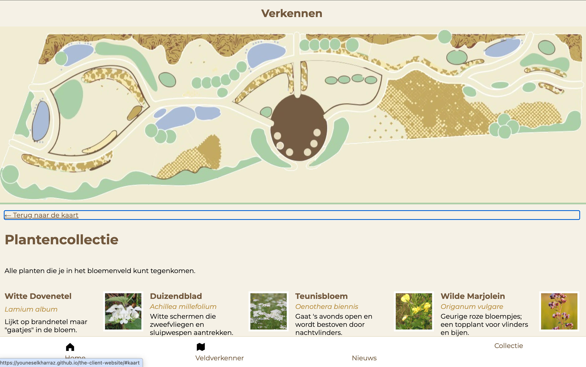
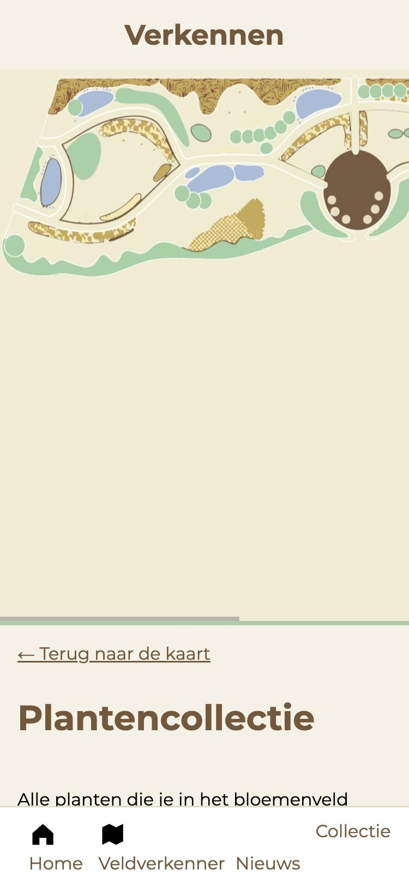
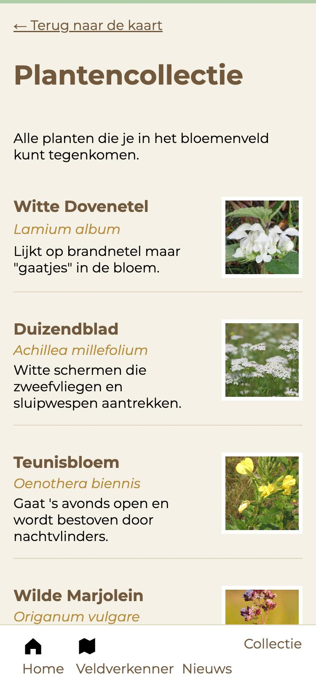
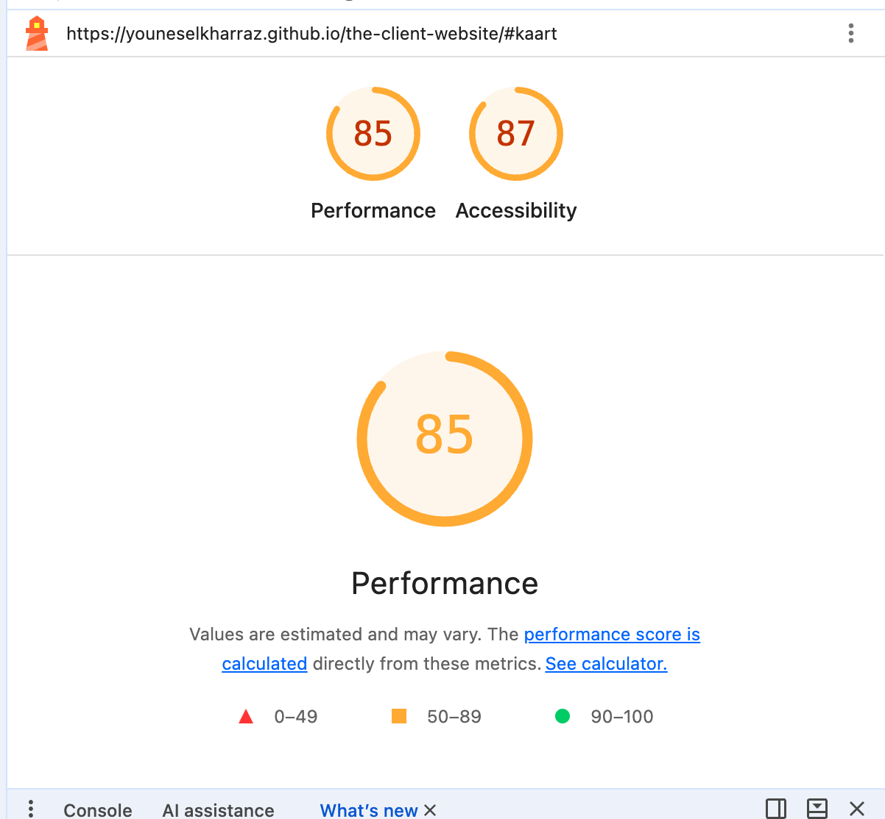

# The Client - Website

Ontwerp en maak een website voor een opdrachtgever en bespreek het resultaat tijdens de Sprint Review.

De instructie van deze leertaak staan in de [WIKI](https://github.com/fdnd-task/the-client-website/wiki)

**Live website:** [https://youneselkharraz.github.io/the-client-website/](https://youneselkharraz.github.io/the-client-website/)

## Inhoudsopgave Readme

  * [Beschrijving](#beschrijving)
  * [Gebruik](#gebruik)
  * [Kenmerken](#kenmerken)
  * [Toegankelijkheid](#toegankelijkheid)
  * [Bronnen](#bronnen)
  * [Licentie](#licentie)

## Beschrijving

**Veldverkenner** is een mobiele webapp voor Bloemenveld Frankendael in Park Frankendael (Amsterdam-Oost). De opdrachtgever wil groene kennis delen en de omgeving groener maken. Bezoekers worden uitgenodigd om de tuin actief te beleven, te ontdekken en te gebruiken.

Bezoekers scannen een QR-code en kunnen direct aan de slag, zonder in te loggen.

**Wat kun je ermee?**
- De kaart van het bloemenveld bekijken.
- In de plantencollectie zien welke planten er staan, met foto, naam, Latijnse naam en een korte beschrijving.

**Opdrachtgever:** Bloemenveld Frankendael, contactpersoon Joost.

## Gebruik

De webapp is gemaakt voor de telefoon. Bovenaan staat de kaart, die je zijwaarts kunt scrollen. Daaronder staat de plantencollectie. Met het menu onderin spring je tussen de kaart en de collectie.

 

## Kenmerken

**HTML**
- Semantische structuur met `main`, `article` en `nav`.
- Elk plantenkaartje is een `article` met een afbeelding, kop, Latijnse naam en beschrijving.
- Alle afbeeldingen hebben een `alt`-tekst.

**CSS**
- Mobile first, met één media query voor grotere schermen.
- Custom properties voor de kleuren uit de stijlgids.
- CSS Grid voor de plantenkaartjes en de navigatie onderin.
- `position: sticky` voor de titel op de kaart en `position: fixed` voor de navigatie.

**Nog uit te werken**
- Zones op de kaart (Zuid, Midden en Noord) met alle paden zichtbaar.
- Een interactieve kaartlaag met per plant wat je ermee kunt doen: ruiken, voelen, iets mee maken of een bijzondere eigenschap.
- Een collectiefunctie voor het verzamelen van planten of locaties, pas nadat de webapp compleet is.
- De vier kleuren van de opdrachtgever voor de huisstijl.

## Toegankelijkheid

Ik heb een WCAG-audit gedaan met Lighthouse, het toetsenbord en de ontwikkelaarstools. Lighthouse geeft de pagina **87 voor Toegankelijkheid** en **85 voor Performance**.

Het belangrijkste verbeterpunt is het contrast van de Latijnse plantnamen (2,80 : 1, en het moet minstens 4,5 : 1 zijn).

Het hele verslag lees je hier: [WCAG-audit](docs/wcag-audit.md)

## Bronnen

- [MDN Web Docs](https://developer.mozilla.org/)
- [OpenStreetMap](https://www.openstreetmap.org/#map=19/52.351615/4.931402&layers=D) voor de paden
- [Montserrat via Google Fonts](https://fonts.google.com/specimen/Montserrat)
- [The A11Y Project – Checklist](https://www.a11yproject.com/checklist/)

## Licentie

This project is licensed under the terms of the [MIT license](./LICENSE).
